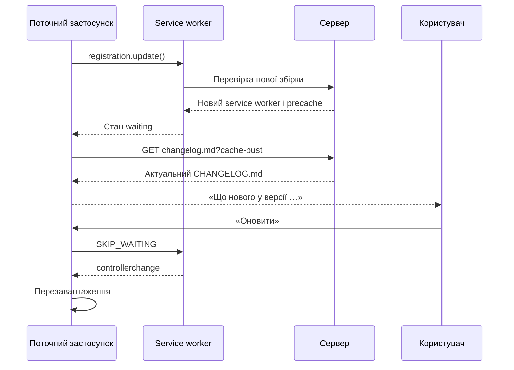

# Показ «Що нового» до активації оновлення PWA

## Мета

Коли застосунок знаходить нову версію, користувач має змогу прочитати зміни перед натисканням «Оновити». Єдиним джерелом цих даних залишається кореневий файл `CHANGELOG.md`.

## Важливе обмеження поточної реалізації

Зараз `pwaUpdate.ts` позначає оновлення доступним лише після переходу нового service worker у стан `installed` / `waiting`. На цей момент Workbox уже завантажив і поклав у precache файли нової збірки.

Отже, у поточній архітектурі реально показати зміни **до активації нової версії та перезапуску застосунку**, але не до її фонового завантаження. Саме цей варіант рекомендовано реалізувати: він відповідає очікуваній поведінці кнопки «Оновити» та не ускладнює service worker.

Якщо потрібно буквально не завантажувати файли нової версії до згоди користувача, потрібен власний service worker. Цей варіант описано наприкінці документа.

## Рекомендована схема

Під час production-збірки Vite має опублікувати актуальний `CHANGELOG.md` як окремий статичний файл `changelog.md`. Цей файл не можна додавати до precache. Коли з’являється waiting service worker, стара версія застосунку завантажує `changelog.md` без HTTP-кешу, парсить його наявним парсером і показує записи, новіші за встановлену версію.



## Крок 1. Зробити `CHANGELOG.md` єдиним джерелом версії

Зараз версія `1.0.23` записана вручну в `AboutSection.tsx`. Це створює ризик, що номер у застосунку та перший запис ченжлогу розійдуться.

Потрібно створити модуль, наприклад `src/releaseInfo.ts`, який:

1. Імпортує кореневий файл через Vite `?raw`.
2. Викликає наявний `parseChangelog()`.
3. Експортує повний список релізів і номер першого релізу як поточну версію.
4. Кидає помилку під час збірки, якщо ченжлог порожній або перший запис не має коректної версії.

```ts
import changelogMarkdown from '../../../CHANGELOG.md?raw';
import { parseChangelog } from '@/lib/changelog';

export const INSTALLED_RELEASES = parseChangelog(changelogMarkdown);

if (!INSTALLED_RELEASES.length) {
  throw new Error('CHANGELOG.md does not contain releases');
}

export const INSTALLED_VERSION = INSTALLED_RELEASES[0].version;
```

`AboutSection.tsx` і `ChangelogPage.tsx` мають використовувати цей модуль замість власного номера версії та окремого імпорту Markdown.

## Крок 2. Публікувати ченжлог як окремий мережевий ресурс

У `vite.config.ts` потрібно додати невеликий build-плагін, який читає кореневий `CHANGELOG.md` і додає його до результату збірки під стабільною назвою `changelog.md`.

Схематично:

```ts
import fs from 'node:fs';
import path from 'node:path';
import type { Plugin } from 'vite';

function changelogAsset(): Plugin {
  const changelogPath = path.resolve(import.meta.dirname, '..', '..', 'CHANGELOG.md');

  return {
    name: 'changelog-asset',
    apply: 'build',
    generateBundle() {
      this.emitFile({
        type: 'asset',
        fileName: 'changelog.md',
        source: fs.readFileSync(changelogPath, 'utf8'),
      });
    },
  };
}
```

Плагін потрібно додати до масиву `plugins` перед `VitePWA()`.

Не слід завантажувати ченжлог із GitHub: репозиторій приватний, а додавання GitHub-токена в клієнтський застосунок розкриє його користувачам.

## Крок 3. Гарантувати мережеве отримання актуального файла

Поточний `globPatterns` включає лише `js`, `css`, `html`, `ico`, `png` і `svg`, тому `changelog.md` не потрапить до precache. Це треба зафіксувати явно, щоб майбутня зміна glob не зламала сценарій.

У налаштуваннях Workbox потрібно:

1. Додати `changelog.md` до `globIgnores`.
2. Додати для нього стратегію `NetworkOnly`.

```ts
workbox: {
  globPatterns: ['**/*.{js,css,html,ico,png,svg}'],
  globIgnores: ['**/changelog.md'],
  runtimeCaching: [
    {
      urlPattern: ({ url }) => url.pathname.endsWith('/changelog.md'),
      handler: 'NetworkOnly',
    },
  ],
}
```

Клієнтський запит також має використовувати `cache: 'no-store'` і унікальний query-параметр. Це захищає від кешу браузера та більшості CDN-кешів.

```ts
function getRemoteChangelogUrl(): string {
  const baseUrl = new URL(import.meta.env.BASE_URL, window.location.origin);
  const url = new URL('changelog.md', baseUrl);
  url.searchParams.set('update-check', Date.now().toString());
  return url.href;
}

const response = await fetch(getRemoteChangelogUrl(), {
  cache: 'no-store',
  headers: { Accept: 'text/markdown' },
});
```

Необхідно перевіряти `response.ok` і обмежити максимальний прийнятний розмір відповіді, наприклад 256 КБ.

## Крок 4. Завантажувати нотатки після появи waiting worker

Стан у `pwaUpdate.ts` потрібно розширити:

```ts
type ReleaseNotesState =
  | { status: 'idle' }
  | { status: 'loading' }
  | { status: 'ready'; latestVersion: string; releases: ChangelogRelease[] }
  | { status: 'error'; message: string };

type PwaUpdateState = {
  updateAvailable: boolean;
  isUpdating: boolean;
  releaseNotes: ReleaseNotesState;
};
```

У `markUpdateAvailable()` після збереження waiting worker потрібно асинхронно викликати `loadReleaseNotes()`. Саме оновлення не повинно чекати завершення цього запиту.

```ts
function markUpdateAvailable(worker: ServiceWorker | null) {
  if (!worker || !navigator.serviceWorker.controller) return;

  waitingWorker = worker;
  emit({ updateAvailable: true });
  void loadReleaseNotes();
}
```

Потрібно також експортувати функцію повторного завантаження нотаток, щоб користувач міг натиснути «Спробувати ще раз» після мережевої помилки.

## Крок 5. Вибрати лише ще не встановлені версії

Після отримання Markdown потрібно:

1. Розпарсити його через `parseChangelog()`.
2. Перевірити, що перший запис містить коректний номер версії.
3. Порівняти кожну версію з `INSTALLED_VERSION` числовим semver-порівнянням.
4. Залишити всі версії, новіші за встановлену.

Не можна порівнювати версії як звичайні рядки: наприклад, рядок `1.0.10` лексикографічно менший за `1.0.9`.

```ts
function compareVersions(left: string, right: string): number {
  const a = left.split('.').map(Number);
  const b = right.split('.').map(Number);

  for (let index = 0; index < Math.max(a.length, b.length); index += 1) {
    const difference = (a[index] ?? 0) - (b[index] ?? 0);
    if (difference !== 0) return difference;
  }

  return 0;
}

const newReleases = remoteReleases.filter(
  release => compareVersions(release.version, INSTALLED_VERSION) > 0,
);
```

Якщо користувач пропустив кілька оновлень, потрібно показати всі проміжні записи, а не лише найновіший.

## Крок 6. Додати інтерфейс «Що нового»

У картці «Про додаток» при `updateAvailable === true` потрібно показувати:

- текст `Доступна версія 1.0.24`, якщо номер вдалося отримати;
- кнопку або посилання `Що нового`;
- наявну кнопку `Оновити`.

Після натискання `Що нового` відкривається окремий dialog / bottom sheet зі станами:

- `loading` — індикатор завантаження;
- `ready` — список нових релізів;
- `error` — коротке повідомлення та кнопка повторної спроби.

Кнопка `Оновити` має залишатися доступною навіть тоді, коли ченжлог не завантажився або не розпарсився. Release notes — допоміжна функція, а не умова оновлення.

Щоб не дублювати розмітку, картку одного релізу варто винести з `ChangelogPage.tsx` у компонент на кшталт `ChangelogReleaseCard.tsx` і використовувати:

- на повній сторінці журналу змін;
- у діалозі «Що нового».

Текст із Markdown потрібно й надалі рендерити як React-вузли через контрольований парсер. Не можна використовувати `dangerouslySetInnerHTML`.

## Крок 7. Обробити збої та гонки

Реалізація має враховувати такі ситуації:

1. **Немає мережі.** Показати помилку отримання опису, але дозволити активувати вже завантажений waiting worker.
2. **CDN ще повертає старий файл.** Повторити запит при відкритті діалогу з новим cache-busting параметром.
3. **Ченжлог не містить новішої версії.** Не показувати вигаданих даних; вивести `Опис оновлення ще недоступний` і залишити кнопку оновлення.
4. **Кілька швидких перевірок.** Використати ідентифікатор запиту або `AbortController`, щоб застаріла відповідь не перезаписала новішу.
5. **Новий waiting worker замінив попередній.** Скинути release-notes state і завантажити дані заново.
6. **Пошкоджений Markdown.** Відхилити результат, якщо немає жодного коректного релізу або нові записи не мають розділів.

## Крок 8. Додати автоматичну перевірку ченжлогу

До `pnpm typecheck` або `pnpm build` потрібно додати перевірку, яка завершує збірку з помилкою, якщо:

- немає жодного релізу;
- версії мають некоректний формат;
- версії не впорядковані від нової до старої;
- версія повторюється;
- реліз не має дати, розділу або пунктів;
- опублікований `dist/public/changelog.md` не збігається з кореневим `CHANGELOG.md`.

Це зробить обов’язкове оновлення ченжлогу частиною процесу збірки, а не лише текстовою інструкцією для розробника або ШІ.

## Крок 9. Перевірити PWA-сценарій двома збірками

Для інтеграційної перевірки потрібні дві production-збірки:

1. Зібрати та запустити версію `A`.
2. Відкрити її, дочекатися активації service worker і перезавантажити сторінку.
3. Замінити файли на сервері збіркою версії `B` з новим записом у `CHANGELOG.md`.
4. У застосунку версії `A` запустити перевірку оновлень.
5. Переконатися, що з’явилося повідомлення про версію `B`.
6. Відкрити «Що нового» та перевірити зміни версії `B` до активації waiting worker.
7. Переконатися, що інтерфейс усе ще показує встановлену версію `A`.
8. Натиснути «Оновити» та перевірити перезавантаження у версію `B`.
9. Повторити тест без мережі після появи waiting worker: опис може бути недоступним, але активація оновлення має працювати.
10. Перевірити перехід через кілька версій, наприклад із `1.0.23` одразу на `1.0.26`.

## Крок 10. Послідовність випуску

Перша версія з цією функцією не зможе показати власний опис користувачам старої версії: у старому JavaScript ще немає коду для завантаження та показу віддаленого ченжлогу.

Практична послідовність:

1. Випустити реалізацію як версію `1.0.24`.
2. Користувачі `1.0.23` один раз оновляться без нового діалогу.
3. Починаючи з оновлення `1.0.24 → 1.0.25`, опис нової версії буде доступний до її активації.

## Варіант із буквальним завантаженням лише після згоди

Якщо вимога означає, що до натискання «Оновити» не можна завантажувати навіть precache нової збірки, `vite-plugin-pwa` у режимі `generateSW` не підходить. Браузер автоматично встановлює знайдений новий service worker, а Workbox наповнює precache на етапі `install`.

Для суворого сценарію потрібно:

1. Перейти з `generateSW` на `injectManifest`.
2. Реалізувати власний service worker, який під час `install` не завантажує повний app shell.
3. Виявляти нову версію окремим мережевим запитом до `changelog.md` або згенерованого `release.json`.
4. Показувати release notes у поточному застосунку.
5. Після згоди користувача надсилати waiting worker повідомлення `PREPARE_UPDATE`.
6. Лише після цього завантажувати та перевіряти всі файли нового precache.
7. Після успішного кешування надсилати `SKIP_WAITING` і перезавантажувати застосунок.
8. У разі помилки залишати старий service worker активним і не видаляти його кеш.

Цей варіант значно складніший: потрібно самостійно забезпечити атомарність кешу, відкат після часткового завантаження та сумісність між старою сторінкою і waiting worker. Для цього застосунку він не дає достатньої практичної користі порівняно з рекомендованим показом змін до активації.

## Орієнтовні зміни файлів

| Файл | Зміна |
| --- | --- |
| `CHANGELOG.md` | Залишається єдиним джерелом версій і тексту змін |
| `artifacts/perekladychka/vite.config.ts` | Публікація `changelog.md` та виключення його з кешу |
| `artifacts/perekladychka/src/releaseInfo.ts` | Встановлена версія та вбудований ченжлог |
| `artifacts/perekladychka/src/lib/changelog.ts` | Порівняння версій і вибір нових релізів |
| `artifacts/perekladychka/src/pwaUpdate.ts` | Завантаження віддалених release notes і нові стани |
| `artifacts/perekladychka/src/components/settings/AboutSection.tsx` | Кнопка «Що нового» та номер доступної версії |
| `artifacts/perekladychka/src/components/settings/ReleaseNotesDialog.tsx` | Діалог нових змін |
| `artifacts/perekladychka/src/components/changelog/ChangelogReleaseCard.tsx` | Спільне відображення одного релізу |
| `artifacts/perekladychka/src/pages/ChangelogPage.tsx` | Використання спільної картки та `releaseInfo.ts` |
| Скрипт перевірки | Валідація порядку, унікальності та повноти ченжлогу |

## Критерії готовності

- При появі waiting worker користувач бачить номер доступної версії.
- «Що нового» показує дані з `CHANGELOG.md`, опублікованого разом із новою збіркою.
- Для пропущених оновлень показуються всі новіші версії.
- Перегляд опису не активує service worker і не перезавантажує застосунок.
- Помилка отримання опису не блокує кнопку «Оновити».
- `changelog.md` не повертається зі старого precache.
- Номер встановленої версії автоматично береться з першого запису ченжлогу.
- Збірка завершується помилкою, якщо `CHANGELOG.md` має несумісний формат.

## Довідкові джерела

- [MDN: `ServiceWorkerRegistration.update()`](https://developer.mozilla.org/en-US/docs/Web/API/ServiceWorkerRegistration/update)
- [Workbox: параметри `generateSW`, `runtimeCaching` і `SKIP_WAITING`](https://developer.chrome.com/docs/workbox/modules/workbox-build)
- [Vite PWA: стратегія `generateSW`](https://vite-pwa-org.netlify.app/workbox/generate-sw)
- [Vite PWA: відмінність між `generateSW` та `injectManifest`](https://vite-pwa-org.netlify.app/workbox/)
