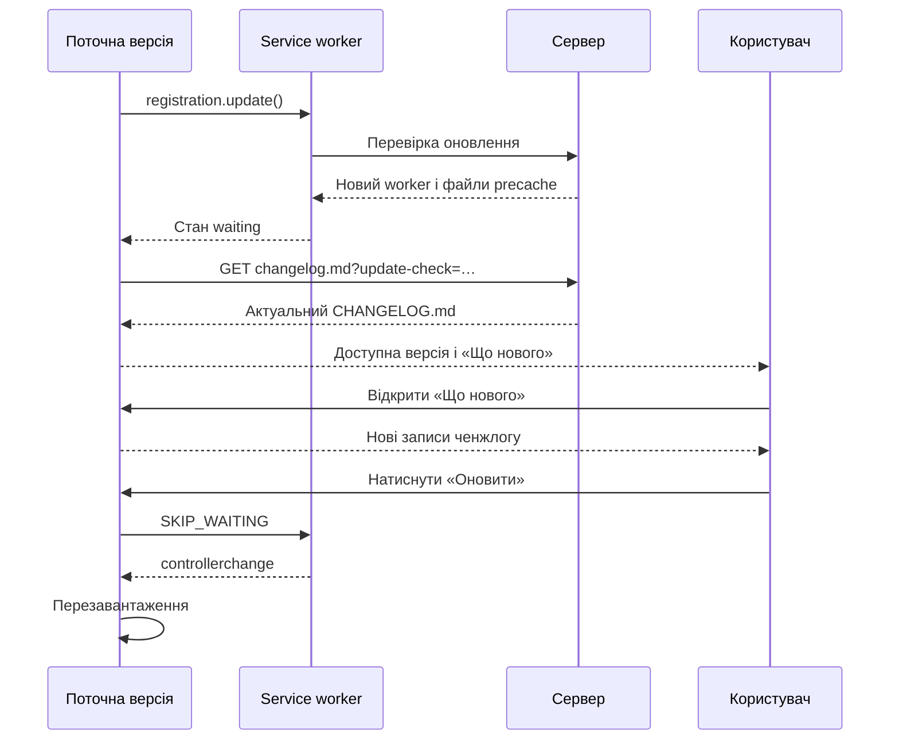

# Показ «Що нового» до активації оновлення PWA

## Мета

Коли нова версія вже завантажена та її service worker очікує активації, користувач має змогу прочитати зміни й сам вирішити, коли натиснути «Оновити». До цього моменту застосунок продовжує працювати на поточній версії.

Єдиним джерелом номера версії та опису змін залишається кореневий файл `CHANGELOG.md`.

## Обраний сценарій

`vite-plugin-pwa` генерує service worker у режимі `generateSW`. Браузер знаходить новий worker, а Workbox під час його встановлення завантажує файли нової збірки до precache. Після цього worker переходить у стан `waiting`.

Саме стан `waiting` означає, що оновлення доступне в інтерфейсі:

- нова збірка вже завантажена;
- поточна сторінка й активний service worker продовжують обслуговувати стару версію;
- перегляд «Що нового» не активує оновлення;
- лише натискання «Оновити» надсилає waiting worker повідомлення `SKIP_WAITING`;
- після `controllerchange` сторінка перезавантажується й починає використовувати нову версію.

Сценарій показу змін до завантаження нової збірки не підтримується і для цього застосунку не потрібен.



## 1. Вбудована інформація про встановлену версію

Модуль `src/releaseInfo.ts` імпортує кореневий `CHANGELOG.md` через Vite `?raw`, перевіряє його формат і експортує:

- `INSTALLED_RELEASES` — записи, вбудовані в поточну збірку;
- `INSTALLED_VERSION` — номер першого, тобто найновішого, запису.

`AboutSection.tsx` використовує `INSTALLED_VERSION` замість вручну записаного номера. `ChangelogPage.tsx` використовує `INSTALLED_RELEASES`, тому номер у налаштуваннях і сторінка журналу змін завжди формуються з одного джерела.

## 2. Публікація ченжлогу нової збірки

Build-плагін `changelog-asset` у `vite.config.ts`:

1. Читає кореневий `CHANGELOG.md`.
2. Перевіряє структуру, версії, порядок і наповненість записів.
3. Публікує той самий текст у збірці під стабільною назвою `changelog.md`.

Файл не завантажується з GitHub: репозиторій приватний, а клієнтський застосунок не повинен містити GitHub-токен.

## 3. Ченжлог не потрапляє до кешу старої версії

`changelog.md` явно доданий до `globIgnores`, а runtime route для нього використовує `NetworkOnly`. Клієнтський запит додатково має:

- `cache: 'no-store'`;
- заголовок `Accept: text/markdown`;
- унікальний query-параметр `update-check`.

Тому стара версія застосунку після появи waiting worker запитує `changelog.md`, опублікований разом із новою збіркою, а не копію зі свого precache.

Сервер або CDN також має не кешувати `changelog.md` надовго. Query-параметр захищає від типового URL-кешування, але конфігурація хостингу не повинна примусово ігнорувати query string.

## 4. Завантаження опису оновлення

Стан PWA-оновлення містить окремий стан release notes:

```ts
type ReleaseNotesState =
  | { status: 'idle' }
  | { status: 'loading' }
  | { status: 'ready'; latestVersion: string; releases: ChangelogRelease[] }
  | { status: 'error'; message: string };
```

Коли worker переходить у `waiting`, `pwaUpdate.ts`:

1. Зберігає посилання на waiting worker.
2. Встановлює `updateAvailable: true`.
3. Одразу починає мережеве завантаження `changelog.md`.
4. Не активує worker і не блокує кнопку «Оновити» очікуванням відповіді.

При відкритті діалогу «Що нового» запит виконується повторно. Це допомагає, якщо CDN спочатку повернув попередній файл. Кнопка «Спробувати ще раз» запускає той самий запит після помилки.

Відповідь приймається лише якщо:

- HTTP-статус успішний;
- розмір не перевищує 256 КБ;
- Markdown містить валідні, повні записи релізів.

`AbortController` та ідентифікатор запиту не дозволяють старішій відповіді перезаписати результат новішої перевірки.

## 5. Вибір ще не встановлених версій

Отриманий Markdown парситься тим самим кодом, що й вбудований ченжлог. Після валідації залишаються лише записи, версія яких новіша за `INSTALLED_VERSION`.

Версії порівнюються числово за трьома semver-компонентами. Рядкове порівняння не використовується, бо, наприклад, `1.0.10` лексикографічно менше за `1.0.9`.

Якщо користувач пропустив кілька оновлень, діалог показує всі проміжні записи від найновішого до найстарішого.

Якщо опублікований ченжлог ще не містить новішої версії, застосунок показує «Опис оновлення ще недоступний», але дозволяє встановити вже завантажене оновлення.

## 6. Інтерфейс у налаштуваннях

Картка «Про додаток» показує:

- встановлену версію з вбудованого ченжлогу;
- `Доступна версія X.Y.Z`, коли віддалений ченжлог завантажився;
- резервний текст `Доступна нова версія`, поки номер невідомий;
- кнопку `Що нового`;
- кнопку `Оновити`.

Діалог `ReleaseNotesDialog.tsx` має три видимі стани:

- завантаження;
- список нових релізів;
- повідомлення про помилку з повторною спробою.

Компонент `ChangelogReleaseCard.tsx` відповідає за відображення одного запису й використовується і в діалозі, і на повній сторінці журналу змін. Markdown не передається в `dangerouslySetInnerHTML`.

## 7. Активація залишається ручною

Release notes є лише додатковою інформацією. Незалежно від їхнього стану кнопка «Оновити» залишається доступною.

Після натискання кнопки `applyPwaUpdate()`:

1. Бере worker із `registration.waiting` або зі збереженого посилання.
2. Надсилає `{ type: 'SKIP_WAITING' }`.
3. Чекає `controllerchange`.
4. Перезавантажує сторінку.
5. Використовує резервне перезавантаження через 8 секунд, якщо подія не надійшла.

До натискання кнопки цей код не виконується.

## 8. Перевірка формату під час збірки

`validateChangelog()` завершує збірку з помилкою, якщо:

- немає жодного релізу;
- версія не відповідає формату `X.Y.Z`;
- версія повторюється;
- записи не впорядковані від нових до старих;
- реліз не має розділу;
- розділ не має жодного пункту.

Той самий валідований текст передається в `emitFile`, тому опублікований `changelog.md` збігається з кореневим `CHANGELOG.md`.

## Перевірка PWA-сценарію двома збірками

1. Зібрати та запустити версію `A`.
2. Відкрити її, дочекатися активації service worker і перезавантажити сторінку.
3. Опублікувати збірку `B` з новим записом у `CHANGELOG.md`.
4. У версії `A` запустити перевірку оновлень або повернутися до застосунку після публікації.
5. Дочекатися, поки новий worker перейде у `waiting`.
6. Переконатися, що налаштування показують доступну версію `B`.
7. Відкрити «Що нового» та перевірити записи версії `B` до активації worker.
8. Переконатися, що інтерфейс усе ще показує встановлену версію `A`.
9. Натиснути «Оновити» та перевірити перезавантаження у версію `B`.
10. Повторити тест без мережі після появи waiting worker: опис може бути недоступним, але активація має працювати.
11. Перевірити перехід через кілька версій, наприклад із `1.0.24` одразу на `1.0.27`.

## Послідовність першого випуску

Версія `1.0.24` додає цей механізм, але встановлена `1.0.23` ще не містить коду для показу віддаленого ченжлогу. Тому користувачі один раз оновляться старим способом.

Починаючи з переходу `1.0.24 → 1.0.25`, опис нової версії буде доступний до її ручної активації.

## Змінені файли

| Файл | Призначення |
| --- | --- |
| `CHANGELOG.md` | Версія та опис помітних змін |
| `artifacts/perekladychka/vite.config.ts` | Валідація, публікація й `NetworkOnly` для `changelog.md` |
| `artifacts/perekladychka/src/releaseInfo.ts` | Встановлена версія та вбудовані релізи |
| `artifacts/perekladychka/src/lib/changelog.ts` | Парсинг, валідація і порівняння версій |
| `artifacts/perekladychka/src/pwaUpdate.ts` | Завантаження release notes та керування станом |
| `artifacts/perekladychka/src/components/settings/AboutSection.tsx` | Доступна версія та кнопки оновлення |
| `artifacts/perekladychka/src/components/settings/ReleaseNotesDialog.tsx` | Діалог «Що нового» |
| `artifacts/perekladychka/src/components/changelog/ChangelogReleaseCard.tsx` | Спільне відображення релізу |
| `artifacts/perekladychka/src/pages/ChangelogPage.tsx` | Використання спільної картки й release info |
| `artifacts/perekladychka/src/pages/FeaturesPage.tsx` | Актуальний опис PWA-оновлень |

## Критерії готовності

- Оновлення вважається доступним лише після появи waiting worker.
- Перегляд «Що нового» не активує worker і не перезавантажує застосунок.
- Нова версія активується лише після натискання «Оновити».
- Діалог показує всі версії, новіші за встановлену.
- Помилка опису не блокує активацію оновлення.
- `changelog.md` не повертається зі старого precache.
- Встановлена версія автоматично береться з першого запису ченжлогу.
- Некоректний `CHANGELOG.md` зупиняє production-збірку.
